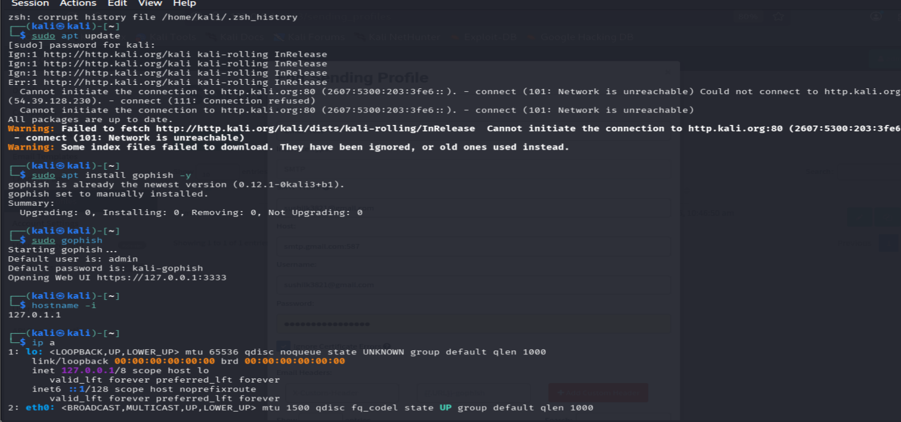
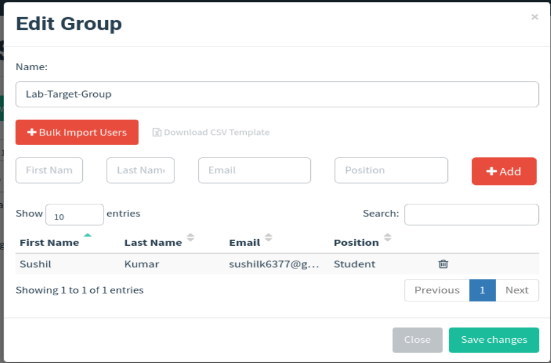
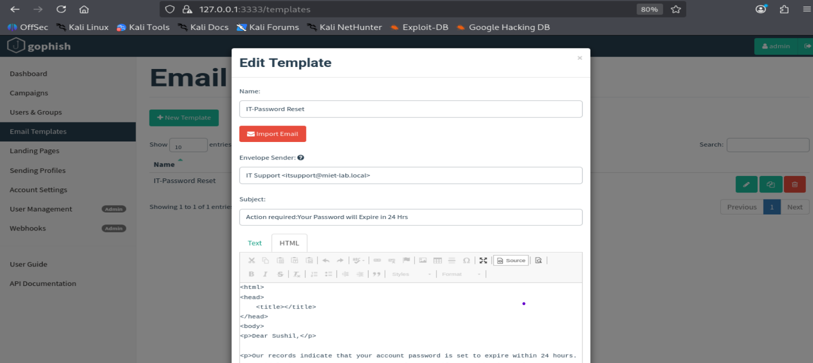
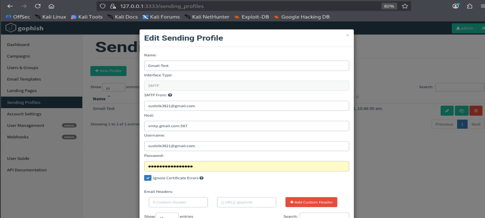
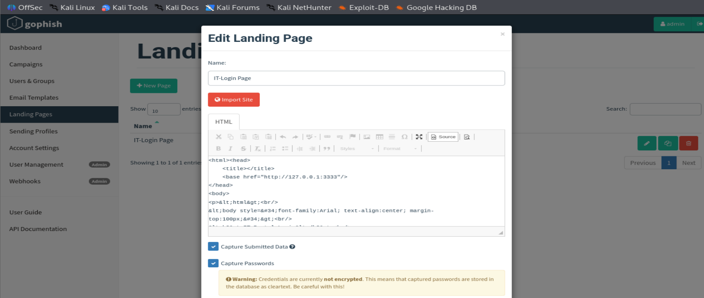
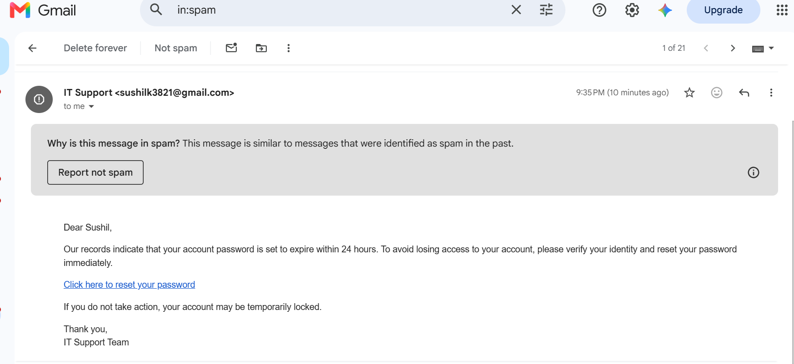
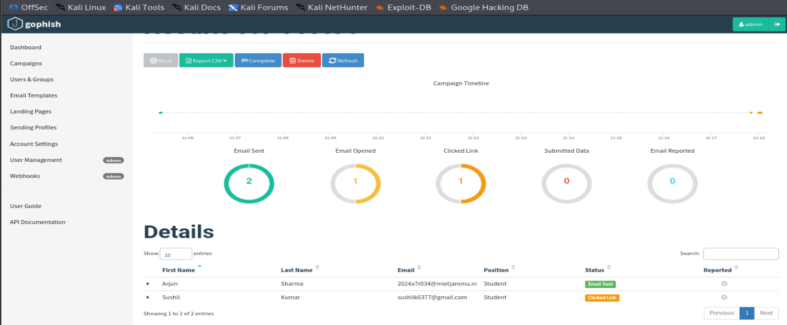

# Experiment 10: GoPhish Phishing Awareness Simulation

## Aim

To document an authorized, controlled phishing-awareness simulation using GoPhish and review the campaign's aggregate delivery and interaction results.

## Scope and safety

This exercise was performed in a lab using a test recipient. Use GoPhish only with explicit authorization and recipients who have consented to participate. Keep simulations isolated from real users and accounts.

The landing-page screenshot shows the options to capture submitted data and passwords enabled. Do not collect real credentials. For future demonstrations, disable password capture, use only dummy data, and remove any test data when the exercise is complete. The screenshots also contain email addresses; redact personal information before sharing them publicly.

## Requirements

- Kali Linux or another authorized lab system
- GoPhish
- A browser for the local GoPhish interface
- A test mailbox and recipient that you control

## Procedure and screenshots

### 1. Start GoPhish in the lab

The terminal screenshot records GoPhish being launched and its local web interface becoming available. The lab setup used the loopback interface; keep the management interface and campaign within the authorized environment.

### 2. Prepare a test recipient group

The recipient screenshot shows a lab group with a single test recipient. Use only a mailbox controlled by the person conducting the exercise or a participant who has agreed to the simulation.

### 3. Review the awareness email template

The template screenshot shows a mock IT password-expiration message. It is included as evidence of the simulation, not as a template for sending deceptive messages to real users.

### 4. Review the sending profile

The screenshot records the configured SMTP sending profile. Keep delivery limited to the authorized test mailbox, and do not publish SMTP passwords, tokens, or other account secrets.

### 5. Review the landing-page settings

The landing-page screenshot records the mock login page and its data-capture settings. Password capture should remain disabled in a safe awareness exercise; use dummy values only if a test submission is needed.

### 6. Check delivery in the test mailbox

The test email appeared in the mailbox's spam folder. This demonstrates receipt by the controlled test mailbox; it does not establish how other mail systems would classify a message.

### 7. Review the campaign summary

The GoPhish campaign summary recorded **2 emails sent, 1 opened, 1 link clicked, 0 data submissions, and 0 reports** at the time of capture. These are the counts displayed in the screenshot and should not be interpreted beyond that observation.

## Result

The screenshots document a GoPhish awareness simulation using a test recipient and a mock IT-themed email. The displayed campaign metrics were 2 sent, 1 opened, 1 link clicked, 0 submitted data, and 0 reported. The test email was visible in the spam folder.

## Conclusion

The exercise documented the setup and observed results of a controlled phishing-awareness simulation. Future exercises should use consented test recipients, avoid real credentials, disable password capture, and redact identifying information before distributing screenshots.
